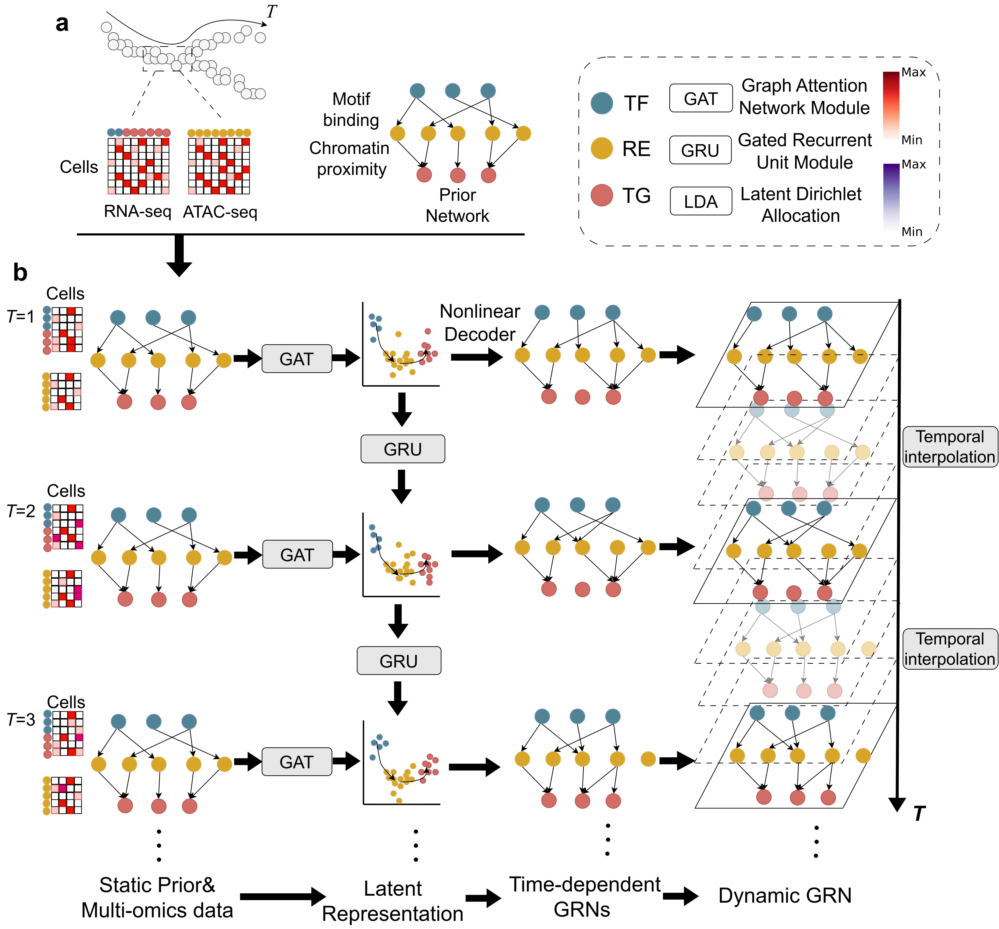

# DRAFT

DRAFT infers dynamic gene regulatory networks from single-cell RNA and ATAC
data along a lineage tree, and compares two lineages by developmental
alignment (DTW) and cell-cell communication (CCC).

> **Status:** DRAFT is being packaged for PyPI. Until the release, install it
> from this repository as shown below. Commands and options may still change.



| Mode | Data |
|---|---|
| Paired | RNA and ATAC measured in the same cells. |
| Unpaired | RNA and ATAC sampled independently, each labelled with the same tree nodes. |

## Installation

Python 3.10 or newer:

```bash
git clone https://github.com/velten-group/DRAFT.git
cd DRAFT
pip install -e ".[full]"
```

`[full]` installs everything the workflow below needs. Optional extras:
`[enrich]` adds GO enrichment of regulatory topics, `[tutorial]` runs the
[interactive example](docs/downstream.ipynb). A GPU speeds up training but is
not required for the examples. Run all commands from this `DRAFT/` directory.

## Quick start

```bash
draft_paired init-config --kind simulation
draft_paired simulation --config configs/draft_simulation_template.yaml
```

This trains on bundled simulated RNA/ATAC data with a known network and writes
to `result/simulation/`: `runs.tsv` summarizes network recovery and temporal
smoothness, and each `seed_*/model_*/` folder holds the model, embeddings,
networks and figures. To simulate data from your own prior network, see
[simulation priors](docs/input_formats.md#simulation-priors).

## Tutorial

**Preprocess → train → networks and clustering → regulons → two-lineage
comparison.** The commands below run as written on the small example inputs
in [`data/`](data/README.md):

| Example | Used in |
|---|---|
| `data/lineage1/`, `data/lineage2/` | All steps: two synthetic lineages with priors |
| `data/ligand_receptor.csv` | Step 5 |
| `data/motif_example/` | Step 1, building priors from motifs |

For a real analysis, replace them with your own files in the same layout
([file formats](docs/input_formats.md)) and use your own TF and tree-node names.

### 1. Preprocess

Each lineage has its own folder:

```text
data/lineage1/
  rna.h5ad, atac.h5ad
  rna_cells.tsv, atac_cells.tsv   # optional if H5AD obs has cell_type
  tree.tsv, TF.tsv, TG.tsv
  TF_RE.tsv, RE_TG.tsv            # optional regulatory priors
```

```bash
draft preprocess --input-dir data/lineage1 --mode unpaired --output prepared/lineage1
draft preprocess --input-dir data/lineage2 --mode unpaired --output prepared/lineage2
```

- Use `--mode paired` when RNA and ATAC come from the same cells.
- Without `TF_RE.tsv`/`RE_TG.tsv`, add `--genome hg38`, `mm10` or `dm6`; DRAFT
  then builds motif-based priors (internet needed). Example:
  `draft preprocess --input-dir data/motif_example --mode paired --genome dm6 --output prepared/motif_example`
- Paired data with supplied priors need [gene coordinates in `TG.tsv`](docs/input_formats.md#tf-and-tg-lists)
  for network export.
- Each output folder receives `graphs.pt` (the model input) and `train.yaml`.

### 2. Train

```bash
draft train --config prepared/lineage1/train.yaml
draft train --config prepared/lineage2/train.yaml
```

Checkpoints go to `result/<lineage>/model/`. With `--output result/my_run`,
use the written `result/my_run/run_config.yaml` in place of `train.yaml`
in later commands.

### 3. Export networks and cluster edges

```bash
draft_unpaired reproduce --config prepared/lineage1/train.yaml
draft_unpaired network-export --config prepared/lineage1/train.yaml
draft_unpaired edge-cluster --config prepared/lineage1/train.yaml
draft_unpaired topic --config prepared/lineage1/train.yaml
```

Use `draft_paired` for paired models. Results go to `result/lineage1/`
(`network/`, `edge_cluster/`, `topic/`); see
[outputs and options](docs/downstream.md#cluster-edges-and-regulatory-topics).

### 4. Inspect TF regulons

```bash
draft_unpaired single-tf --config prepared/lineage1/train.yaml --tf TF1 --stage stage1 --consensus-stages stage1 stage2
```

`TF1` and `stage1`/`stage2` are a TF and tree nodes of the example. Results go
to `result/lineage1/single_tf/`; see [regulon outputs](docs/downstream.md#select-tfs-and-export-regulons).

### 5. Compare two lineages (DTW + CCC)

```bash
draft_paired ccc --lineage1 prepared/lineage1/train.yaml --lineage2 prepared/lineage2/train.yaml --lr data/ligand_receptor.csv --early1 1 --early2 1 --output result/ccc
```

`--early1`/`--early2` give the number of initial stages that form each
lineage's early window. Ligand and receptor genes must be in both lineages'
`TG.tsv`. Any combination of paired and unpaired models works. See the
[ligand-receptor CSV](docs/input_formats.md#communication-between-two-lineages)
and [CCC outputs](docs/downstream.md#compare-two-lineages).

## Documentation

- [Input guide](docs/input_formats.md): data to prepare, file formats, priors
  and motif resources.
- [Network export and downstream analyses](docs/downstream.md): every
  downstream command, its outputs and options.
- [Interactive example](docs/downstream.ipynb): export, clustering and CCC in a
  notebook (`pip install -e ".[full,tutorial]"`).
- `draft --help`, `draft_paired --help`, `draft_unpaired --help` and
  `<command> --help` list all options.

## Reproducing the manuscript

Retrains the mouse and Drosophila models; a GPU with at least **48 GB** is
recommended.

1. Install DRAFT as above.
2. Download `mouse_graphs.pt`, `dro_germ_graphs.pt` and `soma_graphs.pt` from
   [Zenodo](https://doi.org/10.5281/zenodo.23678662) into `DRAFT/graph_data/`.
3. Train:

   ```bash
   python scripts/train_reproduction.py --graph-dir graph_data
   ```

   Add `--dataset mouse`, `dro_germ` or `soma` for one model, or `--check-only`
   to validate the files first.

Results go to `result/reproduction/<dataset>/` (`model/`, `train/`,
`config.yaml`).

To reproduce the manuscript's downstream analyses and figures, use
[DRAFT-analysis](https://github.com/velten-group/DRAFT-analysis).

## Citation

If you use DRAFT, please cite the DRAFT preprint (bioRxiv; link to follow).

## License and contact

MIT, see [LICENSE](LICENSE). Questions and bug reports:
[GitHub issues](https://github.com/velten-group/DRAFT/issues).
